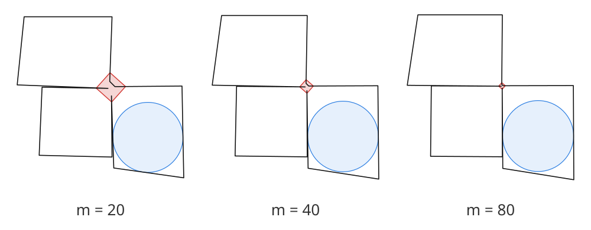
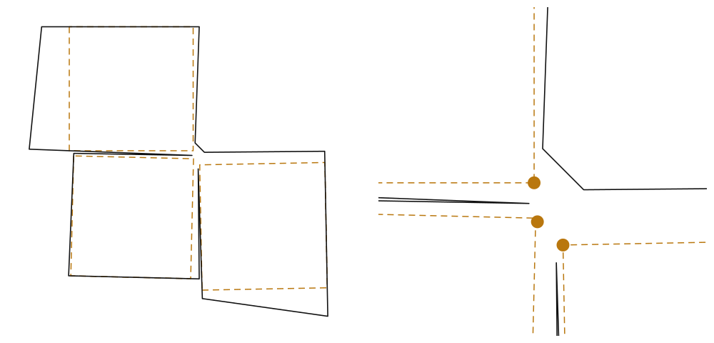
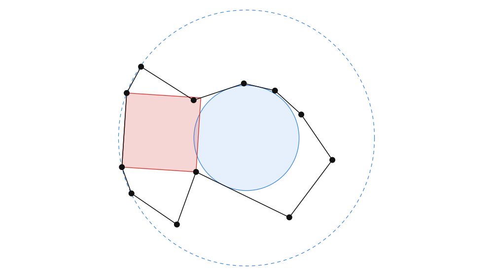
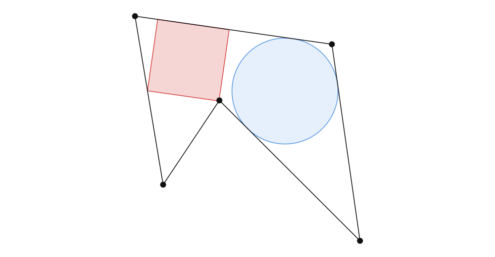

# Inscribed squares can be small

Draw any closed loop that does not cross itself. Can you always find four points
on it that form a square? Nobody knows. The question was asked in 1911 and is
settled for smooth loops and for polygons, but not for arbitrary ones.

This repository contains two small results about how *large* such a square has
to be, each proved by a short exact computation that you can run yourself.

> **A note on where this comes from.** I am a software developer with an
> interest in mathematics, not a mathematician. These results were obtained by
> guiding coding agents, and I have verified them as far as I am able: with the
> programs in this repository, and with independent programs by B. J. Schulz
> that agree on every polygon tested. They may still contain mistakes.
>
> I am making them public because they appear to close two directions that lead
> nowhere, so that others need not spend time or compute rediscovering that. If
> you find an error, please open an issue.

The paper is [paper/paper.pdf](paper/paper.pdf). What follows is the same story
in plain words.

## Why the size of the square matters

Any loop can be approximated by polygons, and every polygon has an inscribed
square. So the general problem would be solved if those squares could not shrink
to nothing as the polygons close in on the loop. A natural hope: a polygon with
room for a big circle inside must also have a big inscribed square. Richard
Schwartz stated this as the *big peg conjecture* (2022):

> There is some ε₀ > 0 such that every polygon containing a disc of radius 1 has
> an inscribed square of side at least ε₀.

## Result 1: the big peg conjecture is false

Take three large rooms around a small hub. Let the rooms grow and leave the hub
alone.



Each corner of this 13-sided polygon is `m × (a fixed point) + (a small nudge)`;
the numbers are in [data/rooms13.txt](data/rooms13.txt). For every `m` from 171 up,
and for the sizes drawn here:

- it contains a circle of radius `2m` (the blue one drawn is the largest in its room, about `3m`);
- it has **exactly one** inscribed square (red), about 30 across, whatever `m` is.

So the circle can be as large as you like while the square stays the same size.
No ε₀ works.

**Why it works.** Wall up the doorway of any one room and that room has only
room-sized squares, each with a corner on the new wall (dashed, left). Remove
the wall and that corner has nothing to rest on (dots, right).



One room alone fails: slide such a square and its loose corner escapes through
the doorway to the outside, crossing the outline on the way, which makes a new
square. A second room behind the doorway lets the corner pass from inside to
inside. Three rooms round one hub make that possible for every room at once.

This does not settle the original problem. Every one of these polygons has a
square. It closes one proposed road to a proof.

## Result 2: Matschke's ring theorem cannot be widened

Benjamin Matschke proved a case where a big square *is* guaranteed. Take a ring
between two circles, the outer one at most 1 + √2 ≈ 2.414 times the inner. Every
loop that stays in the ring and goes once round the hole has an inscribed square
of side at least √2 times the inner radius. He asked whether a wider ring would
do.

It would not. This 12-cornered loop lives in a ring of ratio 2.434, and its only
inscribed square is slightly too small: side √965 ≈ 31.064 against a promised
31.096.



More corners get closer to his limit:

| Corners | Ring ratio | Inscribed squares |
|---:|---:|---:|
| 5 (see the appendix) | 3.162 | 1 |
| 8 | 2.606 | 1 |
| 12 | 2.434 | 1 |
| 16 | 2.424 | 7 |
| 62 | 2.4144 | 11 |
| Matschke's theorem | holds up to 2.4142 | |

So his constant is the true limit to within 0.0002. The ratio fell steadily as
corners were added, and the search was still improving when it stopped. It looks
as if more complicated shapes can come as close to 2.4142 as you like, which
would make his number exactly right. We have not proved that.

## How the squares are found

A square is fixed by one corner `p` and one side `v`: four numbers. Pick four
sides of the polygon and ask that each corner of the square lie on the line
through one of them. That is four linear equations in four unknowns, so there is
at most one candidate. Keep it if its corners land on the sides themselves.

Trying every choice of four sides finds every inscribed square. With fractions
instead of decimals nothing is rounded, so the list is complete and exact. For
the three-room family the same calculation is done with `m` left as a letter;
each test becomes the sign of a polynomial, which cannot change beyond its
largest root. Those roots are located exactly; the largest is below 171.

## Check it yourself

Python 3, nothing to install.

```sh
python3 verify.py            # every claim above except the two below, ~10 s
python3 verify.py --slow     # also the 62-cornered loop, ~10 min
python3 verify_all_m.py data/rooms13.txt --centre 3,-4,0,0 --radius 2 --side 37
                             # result 1 for every m from 171 up, ~3 min
python3 verify.py "0,0;7,0;3,5"      # the squares of your own polygon
```

[verify.py](verify.py) is about 200 lines and written to be read.

**Checked with someone else's code.** [B. J. Schulz's repository](https://github.com/HiroSakuraba/Toeplitz.-Round-peg)
has two exact programs written independently of this one. Run on the pentagon,
the three-room polygon at six sizes, and the 8-, 12- and 16-cornered loops, they
give the same number of squares and exactly the same largest side.

```sh
git clone https://github.com/HiroSakuraba/Toeplitz.-Round-peg
python3 crosscheck.py Toeplitz.-Round-peg/code      # ~4 min
```

The 62-cornered loop and the all-`m` calculation have been checked only by the
programs here.

| File | |
|---|---|
| `verify.py` | finds every inscribed square of a polygon, exactly; checks the claims |
| `verify_all_m.py` | the same with `m` symbolic |
| `crosscheck.py` | compares with B. J. Schulz's independent programs |
| `make_figures.py` | draws the figures from the exact data |
| `data/` | the polygons |
| `paper/paper.pdf` | the paper |
| `paper/src/` | its LaTeX source and figures; `build.sh` renders it |

## How this came about

The work started as an interactive tool for exploring inscribed squares and
turned into a search for extreme shapes. Coding agents proposed and tested
constructions; the survivors were simplified by further search until they had
few corners and small whole-number coordinates, and then put through the exact
checker. Many ideas failed along the way. Only what survived the exact
check is here.

## Credit

- The questions: R. E. Schwartz, *Rectangles, curves, and Klein bottles*, Bull.
  AMS 59 (2022), Conjecture 3.5; B. Matschke, *On the square peg problem and its
  relatives*, [arXiv:1001.0186](https://arxiv.org/abs/1001.0186), Theorem 1.3 and
  Remark 2.6, and his survey in Notices AMS 61 (2014).
- The first polygon below √2: [G. Pochuev](https://github.com/Grisha-Pochuev/sharp-big-peg-counterexample)
  (2026), answering a challenge by D. Bernier, and verified by exhaustive
  enumeration as here.
- [B. J. Schulz's research log](https://github.com/HiroSakuraba/Toeplitz.-Round-peg)
  lowers that ratio to 1.4084, proves a size bound for several families of
  polygons, and names the existence of any universal positive constant as the
  remaining question. Result 1 answers it: there is none.
- For convex curves the √2 bound does hold (C. Boilley, 2026).

We know of no earlier counterexample to the conjecture as stated, nor an answer
to Matschke's question, but the area is active and we may have missed one.

## Appendix: a known fact, with an example you can check by hand

A circle's inscribed square has side √2 times the radius, so one might guess a
polygon always has a square at least √2 times its inner circle. **Grisha Pochuev
showed in August 2026 that this is false**, with a 10-sided polygon of ratio
1.4104, checked by listing every inscribed square. His was the first
counterexample of this kind.

The pentagon (1,2), (3,5), (8,0), (7,7), (0,8) is a smaller example of the same
fact: one inscribed square of side 2.569, a circle of radius 1.886, ratio 1.362.
It is here because it is small enough to verify with pencil and paper, and it is
also the first row of the table above.



## Citing

```bibtex
@misc{paloviita2026squares,
  author = {Olli Paloviita},
  title  = {Inscribed squares can be small: a counterexample to the big peg conjecture},
  year   = {2026},
  url    = {https://github.com/ollipal/small-inscribed-squares}
}
```

Code: MIT. Text and figures: CC BY 4.0.
